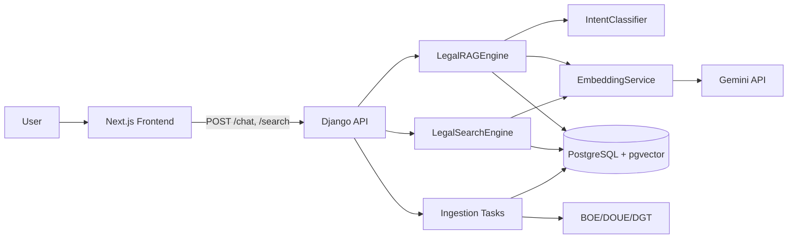

# Artisting Legal GraphRAG System

**AI-powered legal assistant for Spanish artists and cultural professionals**

[](https://github.com)
[](https://www.djangoproject.com/)
[](https://nextjs.org/)
[](https://www.postgresql.org/)
[]()

> **🔗 Parent Project Integration**: This is a **standalone development project** that will be **merged into the main Artisting platform** at `D:\IT workspace\infosubvenciones-api\ARTISTING-main\` post-MVP. The frontend will adopt the parent's **shadcn/ui** design system, **gold accent (#D4AF37)**, and authentication system. See [docs/10_FRONTEND_INTEGRATION_GUIDE.md](docs/10_FRONTEND_INTEGRATION_GUIDE.md).

---

## What is this?

The **Artisting Legal GraphRAG** is a specialized Retrieval-Augmented Generation (RAG) system that helps Spanish artists navigate complex legal questions about:

- **Fiscal** (Taxes): IVA, IRPF, deductions, mecenazgo
- **Laboral** (Labor): Autónomo registration, contracts, social security
- **Propiedad Intelectual** (IP): Copyright, SGAE, royalties
- **Subvenciones** (Grants): Cultural grants, eligibility, applications

### Key Features

- **Hybrid Search**: Semantic (pgvector) + Lexical (PostgreSQL FTS) with RRF fusion
- **Legal Hierarchy**: Respects Spanish legal authority (Constitution > Law > Decree)
- **Source Attribution**: Answers include grounded source lists (BOE, EUR-Lex)
- **Evidence Gating**: Abstains when evidence is weak or off-topic
- **Session Support**: Follow-up questions use recent chat context
- **Artist-Specific**: Tailored examples and language for cultural professionals

---

## Quick Start

### Prerequisites

- Python 3.11+
- Node.js 20+
- PostgreSQL 15+ with pgvector extension
- Redis 7+
- Gemini API key (Google AI)

### 1. Clone Repository

```bash
git clone <repo-url>
cd Legal\ GraphRAG
```

### 2. Backend Setup

```bash
cd backend

# Create virtual environment (optional)
python -m venv venv
source venv/bin/activate  # On Windows: venv\Scripts\activate

# Install dependencies
pip install -r requirements.txt

# Environment variables are already configured in .env

# Run migrations (already applied)
python manage.py migrate

# Enable pgvector
python manage.py dbshell
>>> CREATE EXTENSION IF NOT EXISTS vector;
>>> \q

# Import corpus sources
python manage.py import_corpus_from_excel corpus_normativo_artisting_enriched.xlsx

# Start Celery worker (separate terminal)
celery -A ovra_backend worker -l info

# Ingest P1 sources
python manage.py ingest_all_p1

# Run backend
python manage.py runserver
```

### 3. Frontend Setup

```bash
cd frontend-legal

# Install dependencies
npm install

# Set up environment
cp .env.local.example .env.local
# Edit .env.local with API URL

# Run frontend
npm run dev
```

### 4. Test

```bash
# Backend: http://localhost:8000/api/v1/legal-graphrag/
# Frontend: http://localhost:3001/

# Try a query:
curl -X POST http://localhost:8000/api/v1/legal-graphrag/chat/ \
  -H "Content-Type: application/json" \
  -d '{"query": "¿Puedo deducir gastos de mi home studio?"}'
```

---

## Project Structure

```
Legal GraphRAG/
  backend/
    apps/legal_graphrag/               # Django app
      models.py                        # Database models
      views.py                         # API endpoints
      services/                        # Business logic
        legal_search_engine.py
        legal_rag_engine.py
        ingestion/                     # BOE/DOUE/DGT connectors
      tests/                           # Unit & integration tests
  frontend-legal/                      # Next.js app
    src/app/                           # Pages
    src/components/                    # React components
    src/services/                      # API clients
  docs/                                # Documentation
    00_OVERVIEW.md                     # Start here!
    01_ARCHITECTURE.md
    02_DATA_MODEL.md
    03_INGESTION_GUIDE.md
    04_RETRIEVAL_GUIDE.md
    05_API_SPECIFICATION.md
    06_DEPLOYMENT_GUIDE.md
    07_TESTING_STRATEGY.md
    08_MVP_SPRINT_PLAN.md
    09_FUTURE_ROADMAP.md
    CLAUDE.md                          # AI assistant guide
    CODEX.md                           # Code conventions
  corpus_normativo_artisting_enriched.xlsx  # Legal corpus catalog
```

---

## Documentation

All documentation is in the [`docs/`](./docs/) folder. Start here:

1. **[00_OVERVIEW.md](./docs/00_OVERVIEW.md)** - System overview, goals, scope
2. **[01_ARCHITECTURE.md](./docs/01_ARCHITECTURE.md)** - Technical architecture
3. **[02_DATA_MODEL.md](./docs/02_DATA_MODEL.md)** - Database schema
4. **[03_INGESTION_GUIDE.md](./docs/03_INGESTION_GUIDE.md)** - How to ingest legal sources
5. **[04_RETRIEVAL_GUIDE.md](./docs/04_RETRIEVAL_GUIDE.md)** - Hybrid search implementation
6. **[05_API_SPECIFICATION.md](./docs/05_API_SPECIFICATION.md)** - API endpoints
7. **[06_DEPLOYMENT_GUIDE.md](./docs/06_DEPLOYMENT_GUIDE.md)** - Deployment to Digital Ocean
8. **[07_TESTING_STRATEGY.md](./docs/07_TESTING_STRATEGY.md)** - Testing approach
9. **[08_MVP_SPRINT_PLAN.md](./docs/08_MVP_SPRINT_PLAN.md)** - 1-week MVP plan
10. **[09_FUTURE_ROADMAP.md](./docs/09_FUTURE_ROADMAP.md)** - Post-MVP features
11. **[CLAUDE.md](./docs/CLAUDE.md)** - Instructions for AI assistants
12. **[CODEX.md](./docs/CODEX.md)** - Code conventions
13. **[Chat Evaluation (North Star & rules)](./docs/Chat%20Evaluation/NorthStarGoal.md)** - Quality goal, prompt contract, automated eval rules
14. **[RunBook.md](./docs/RunBook.md)** - How to run backend/frontend locally and smoke-test

---

## Technology Stack

### Backend
- **Framework**: Django 5.2 + Django REST Framework
- **Database**: PostgreSQL 15 + pgvector
- **Task Queue**: Celery + Redis
- **AI**: Google Gemini API (embeddings + chat)

### Frontend
- **Framework**: Next.js 15 + React 19
- **Language**: TypeScript
- **Styling**: Tailwind CSS
- **Components**: Radix UI

### Infrastructure
- **Hosting**: Digital Ocean App Platform
- **Database**: Digital Ocean Managed PostgreSQL
- **SSL**: Let's Encrypt (auto-managed)

---

## MVP Timeline

**Goal**: Functional Legal GraphRAG in 1 week

| Day | Focus | Deliverable |
|-----|-------|-------------|
| 1 | Database & Models | Tables created, corpus imported |
| 2 | Ingestion Pipeline | Can fetch and parse BOE documents |
| 3 | Embeddings & Search | 37 P1 sources ingested, search works |
| 4 | RAG & API | API endpoints functional, answers with citations |
| 5 | Frontend | Web interface deployed |
| 6 | Testing & QA | 80%+ accuracy on test queries |
| 7 | Deployment | Live at legal.artisting.es |

See [08_MVP_SPRINT_PLAN.md](./docs/08_MVP_SPRINT_PLAN.md) for detailed plan.

---

## Usage Examples

### Ask a Legal Question

```bash
# Via API
curl -X POST https://api.artisting.es/api/v1/legal-graphrag/chat/ \
  -H "Content-Type: application/json" \
  -d '{
    "query": "Puedo deducir gastos de mi estudio en casa como artista autonoma?",
    "max_sources": 8
  }'

# Response:
{
  "session_id": "7b3c6d3e-2a0a-4f7c-9b8c-8d4a6c0d3f21",
  "answer": "**Normativa aplicable**\n...",
  "sources": [
    {
      "id": "BOE-A-2006-20764",
      "title": "Ley 35/2006 del IRPF",
      "url": "https://www.boe.es/eli/es/l/2006/11/28/35/con",
      "source_type": "Normativa",
      "relevance_score": 0.83,
      "excerpt": "Son gastos deducibles aquellos que..."
    }
  ],
  "metadata": {
    "area_principal": "Fiscal",
    "model": "gemini-2.5-flash",
    "normativa_count": 3,
    "doctrina_count": 1,
    "jurisprudencia_count": 0,
    "total_sources": 4,
    "abstained": false
  }
}
```

### Ask a Legal Question (V1.1)

```bash
curl -X POST https://api.artisting.es/api/v1/legal-graphrag/v1_1/chat/ \
  -H "Content-Type: application/json" \
  -d '{
    "query": "Puedo deducir gastos de mi estudio en casa como artista autonoma?",
    "max_sources": 8
  }'
```

### Search Legal Documents

```bash
curl -X POST https://api.artisting.es/api/v1/legal-graphrag/search/ \
  -H "Content-Type: application/json" \
  -d '{
    "query": "derechos de autor",
    "limit": 10
  }'
```

Response:
```json
{
  "count": 2,
  "results": [
    {
      "rank": 1,
      "chunk_id": "4b2d3f1e-...",
      "chunk_label": "Articulo 14",
      "chunk_text": "Corresponde al autor...",
      "document_title": "Texto Refundido de la Ley de Propiedad Intelectual",
      "document_id": "BOE-A-1996-8930",
      "document_url": "https://www.boe.es/eli/es/rdleg/1996/04/12/1/con",
      "source_naturaleza": "Normativa",
      "search_method": "hybrid"
    }
  ]
}
```

---

## Testing

### Run Tests

```bash
# All tests
pytest

# Specific test file
pytest apps/legal_graphrag/tests/test_artist_queries.py

# With coverage
pytest --cov=apps.legal_graphrag --cov-report=html
```

### Test Queries (Artist Personas)

**Elena (Visual Artist)**:
- "¿Puedo deducir gastos de mi estudio en casa?"
- "¿Qué IVA aplico al vender cuadros?"

**Carlos (Music Producer)**:
- "¿Cómo tributan los royalties de Spotify?"
- "¿Cómo me doy de alta como autónomo?"

**Ana (Cultural Association)**:
- "¿Qué subvenciones hay para asociaciones culturales?"

See [07_TESTING_STRATEGY.md](./docs/07_TESTING_STRATEGY.md) for full test suite.

---

## Deployment

### Production URLs

- **Frontend**: https://legal.artisting.es
- **API**: https://api.artisting.es/api/v1/legal-graphrag/

### Deploy to Digital Ocean

```bash
# Backend
git push origin main  # Auto-deploys via Digital Ocean App Platform

# Frontend
cd frontend-legal
npm run build
git push origin main  # Auto-deploys

# Verify
curl https://api.artisting.es/api/v1/legal-graphrag/health/
```

See [06_DEPLOYMENT_GUIDE.md](./docs/06_DEPLOYMENT_GUIDE.md) for detailed steps.

---

## Contributing

This is a proprietary project for Artisting. If you're a developer on the team:

1. Read [CODEX.md](./docs/CODEX.md) for code conventions
2. Read [CLAUDE.md](./docs/CLAUDE.md) if you're an AI assistant
3. Follow the Git workflow:
   - Create feature branch: `git checkout -b feat/your-feature`
   - Write tests
   - Submit PR

---

## License

Proprietary - Artisting © 2025

---

## Support

For questions or issues:
- **Technical**: Check docs first, then contact dev team
- **Legal Content**: Contact legal expert for corpus updates
- **Bugs**: Create GitHub issue

---

## Roadmap

### MVP (Week 1) - CURRENT
- ✅ 37 P1 sources ingested
- ✅ Hybrid search working
- ✅ API functional
- ✅ Frontend deployed

### Phase 2 (Months 2-3)
- [ ] P2 source ingestion (23 sources)
- [ ] Multi-turn conversation
- [ ] Cross-encoder reranking

### Phase 3 (Months 4-6)
- [ ] Citation graph
- [ ] Temporal versioning (law changes)
- [ ] Auto-discovery of related laws

### Phase 4 (Months 7-9)
- [ ] Law change monitoring
- [ ] Personalized alerts
- [ ] Analytics dashboard

See [09_FUTURE_ROADMAP.md](./docs/09_FUTURE_ROADMAP.md) for full roadmap.

---

## Architecture Diagram



---

## Key Metrics (MVP Success Criteria)

- ✅ **Coverage**: 37 P1 sources ingested
- ✅ **Accuracy**: 80%+ correct citations
- ✅ **Hallucinations**: 0% invented laws
- ✅ **Speed**: <5s average response time
- ✅ **Uptime**: 99%+

---

**Built with ❤️ for Spanish artists by Artisting**
