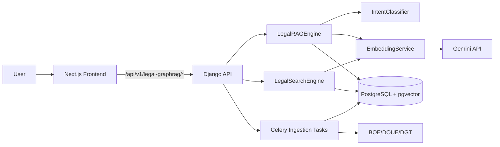

# Legal GraphRAG System - Architecture

## Document Information
- **Version**: 1.1 (MVP build)
- **Last Updated**: 2025-12-16
- **Status**: Implementation In Progress
- **Related**: [00_OVERVIEW.md](./00_OVERVIEW.md) | [02_DATA_MODEL.md](./02_DATA_MODEL.md)

---

## 1. Current Architecture (This Repo)

### High-Level Diagram

### Components (Implemented)

- **Frontend**: Next.js 15 app in `frontend-legal/`
- **API**: Django 5 + DRF in `backend/`
- **RAG**: `LegalRAGEngine` (intent -> retrieval -> prompt -> answer)
- **Search**: Hybrid vector + FTS with RRF fusion
- **Ingestion**: Celery tasks + connectors (BOE/DOUE/DGT)
- **Storage**: PostgreSQL 15 + pgvector
- **Evaluation guardrails**: Chat quality follows the North Star goal and evaluation rules in [docs/Chat Evaluation/](./Chat%20Evaluation/NorthStarGoal.md) and the prompt contract [PROMPT_CONTRACT.md](./Chat%20Evaluation/PROMPT_CONTRACT.md).
- **V1.1 pipeline (planned)**: New versioned services under `backend/apps/legal_graphrag/services/v1_1/` and a separate API endpoint for V1.1.

---

## 2. Technology Stack (Current)

### Backend
- Django 5.2 + Django REST Framework
- PostgreSQL 15 + pgvector
- Celery + Redis
- Gemini API (embeddings + chat)

### Frontend
- Next.js 15 + React 19
- TypeScript
- Tailwind CSS

---

## 3. Planned Integration (Parent Platform)

The project will be merged into the main Artisting platform post-MVP. This repo remains a standalone build until then.

Planned shared components:
- Authentication (JWT)
- Billing (Stripe)
- Unified navigation and user dashboard

Planned routes (in parent platform):
- `/api/v1/auth/*`
- `/api/v1/billing/*`
- `/api/v1/legal-graphrag/*`

---

## 4. Future Architecture Evolution (Post-MVP)

- Cross-encoder reranking
- Citation graph / knowledge graph
- Temporal law versioning
- Law change monitoring and alerts

---

**Document End** | Next: [02_DATA_MODEL.md](./02_DATA_MODEL.md)
