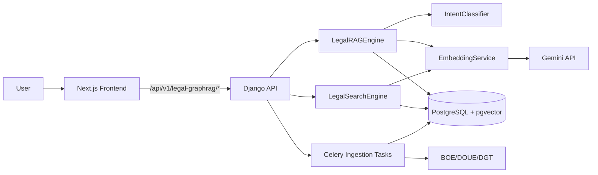

# Legal GraphRAG System - Architecture

## Document Information
- **Version**: 1.1 (MVP build)
- **Last Updated**: 2025-12-21
- **Status**: Implementation In Progress
- **Related**: [00_OVERVIEW.md](./00_OVERVIEW.md) | [02_DATA_MODEL.md](./02_DATA_MODEL.md)

---

## 1. Current Architecture (This Repo)

### High-Level Diagram

### Components (Implemented)

- **Frontend**: Next.js 16 (App Router) app in `frontend-legal/`
- **API**: Django 5 + DRF in `backend/`
- **Orchestrator v1.1**: Turn router (NEW/FOLLOWUP_SLOT_FILL/FOLLOWUP_REFERENTIAL/CLARIFY/META) that uses `session_state` (topic_lock, base_question, pending_slots, slot_values, memory_summary) plus recent messages; rewrites short follow-ups like “por ejemplo?” against the base question.
- **Short memory summary**: Compact per-session summary stored in `session_state.memory_summary` to keep durable context without replaying full chat history.
- **Exact reference resolver**: BOE ID / law-title / artículo detector that forces or boosts the correct chunks before/after hybrid search.
- **RAG**: `LegalRAGEngineV1_1` (intent -> reference resolver -> query expansion -> hybrid retrieval -> prompt -> answer with `<!--CITED_IDS: ... -->`)
- **Search**: Hybrid vector + FTS with RRF fusion
- **Ingestion**: Celery tasks + connectors (BOE/DOUE/DGT)
- **Storage**: PostgreSQL 15 + pgvector
- **Evaluation guardrails**: Chat quality follows the North Star goal and evaluation rules in [docs/Chat Evaluation/](./Chat%20Evaluation/NorthStarGoal.md) and the prompt contract [PROMPT_CONTRACT.md](./Chat%20Evaluation/PROMPT_CONTRACT.md).

---

### V1.1 Runtime Flow (current)

1) **Orchestrator layer** (`views_v1_1` → `orchestrator_v1_1`):
   - Router context: `memory_summary`, `base_question`, last 2 user + last 2 assistant messages, current user_text.
   - Modes: `NEW_QUESTION`, `FOLLOWUP_SLOT_FILL`, `FOLLOWUP_REFERENTIAL`, `CLARIFY`, `META`.
   - Short follow-ups (e.g., “por ejemplo?”, “dame un ejemplo”) are rewritten against the base question or `memory_summary`.
   - Passes `forced_area`, `question_type`, `context_block` to the RAG engine to stabilize retrieval.

2) **Reference resolver + hybrid search** (`legal_rag_engine_v1_1`):
   - Detects BOE IDs / “Ley X/AAAA” / Constitución / artículos; forces or boosts matching chunks.
   - Query expansion → hybrid vector + FTS → dedup/rank → prompt with `<!--CITED_IDS: ... -->`.

3) **State + memory update**:
   - Persists `session_state` fields: `schema_version`, `turn_count`, `topic_lock`, `base_question`, `last_actionable_user_question`, `pending_slots`, `slot_values`, `last_answer_brief`, `memory_summary`.
   - Stores `ChatMessage` rows for user/assistant with sources and decision metadata.

4) **Debug / tracing (opt-in)**:
   - Header `X-Developer-Debug: 1` shows the Developer Dashboard summary (pipeline stages + orchestrator trace).
   - Env `DEBUG_TRACE=1` + header logs full trace to `logs/trace_v1_1.jsonl` and returns it in `metadata.developer_debug.full_trace`.

---

## 2. Technology Stack (Current)

### Backend
- Django 5.2 + Django REST Framework
- PostgreSQL 15 + pgvector
- Celery + Redis
- Gemini API (embeddings + chat)

### Frontend
- Next.js 16 (App Router) + React 19
- TypeScript
- Tailwind CSS

---

## 3. Planned Integration (Parent Platform)

The project will be merged into the main Artisting platform post-MVP. This repo remains a standalone build until then.

Planned shared components:
- Authentication (JWT)
- Billing (Stripe)
- Unified navigation and user dashboard

Planned routes (in parent platform):
- `/api/v1/auth/*`
- `/api/v1/billing/*`
- `/api/v1/legal-graphrag/*`

---

## 4. Future Architecture Evolution (Post-MVP)

- Cross-encoder reranking
- Citation graph / knowledge graph
- Temporal law versioning
- Law change monitoring and alerts

---

**Document End** | Next: [02_DATA_MODEL.md](./02_DATA_MODEL.md)
